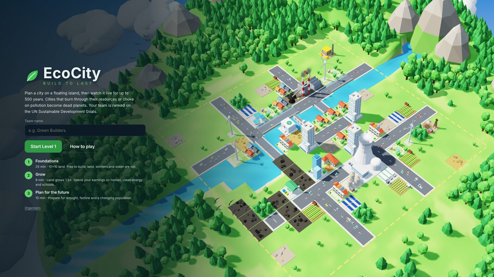
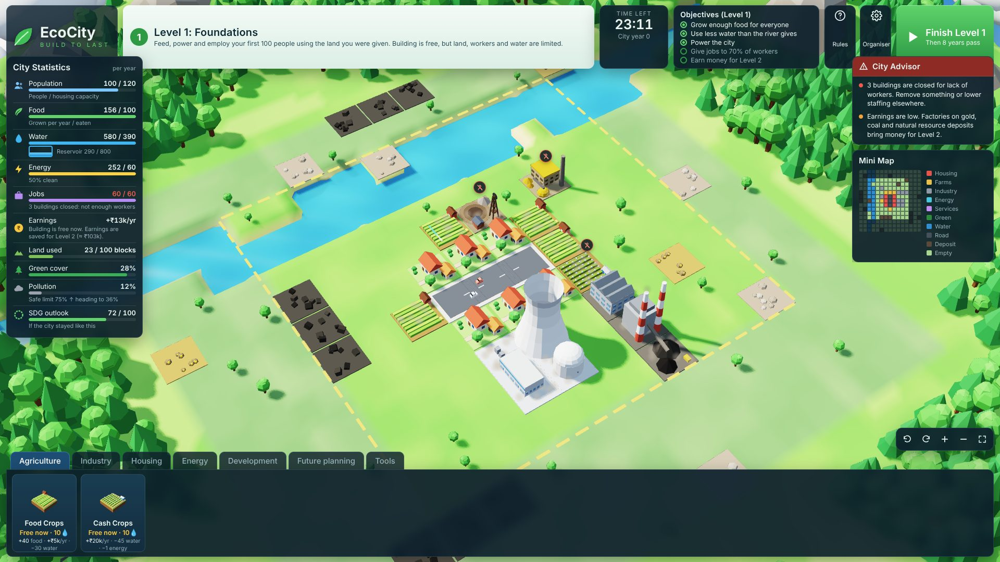
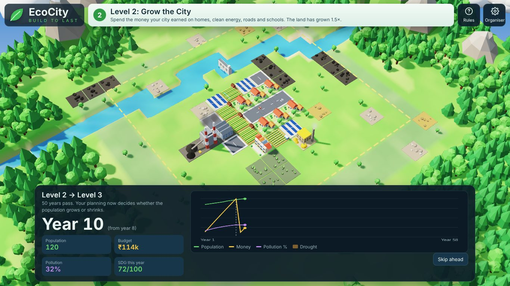
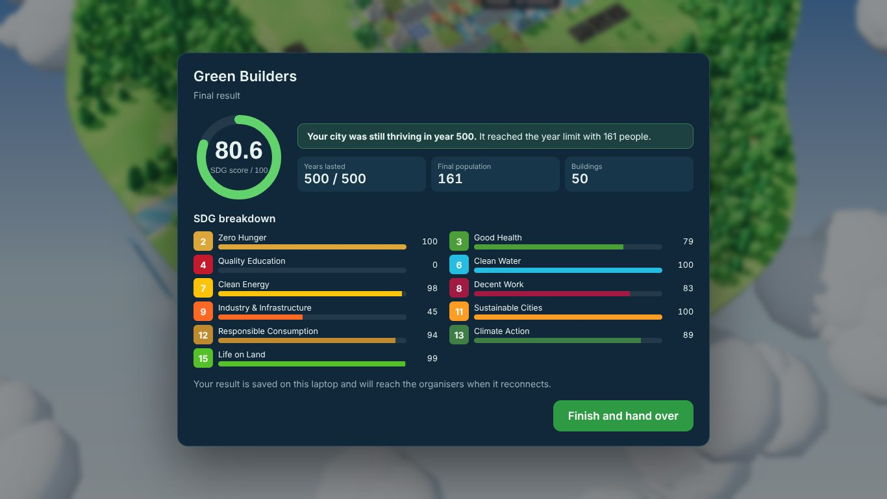

# Eco-city

Sustainability Club – Technozion event.

**EcoCity: Build to Last** is a 3D city-building game about sustainability. Teams plan a city on a floating island over three timed levels. The city then runs on its own for up to 500 (or 1000) years. A city that burns through its resources, starves, or chokes on pollution becomes a dead planet. Teams are ranked on the UN Sustainable Development Goals (SDGs), and organisers see a live leaderboard.



| Level 1 | Time jump | Result |
|---|---|---|
|  |  |  |

## Quick start

You need [Node.js](https://nodejs.org) 18 or newer. There are no packages to install.

```bash
git clone https://github.com/bhaveshkankatala-blip/Eco-city.git
cd Eco-city
npm run build      # creates dist/index.html, the whole game in one file
npm start          # builds and serves it at http://localhost:8080
```

You can also open `dist/index.html` straight from the file system by double-clicking it. The game is a single self-contained HTML file.

## Playing

1. Enter a team name and the team lead's phone number, then start Level 1.
2. Pick a building from the bar at the bottom, then click a block on the map. A green see-through preview shows where it will go; red means it can't go there, and the tooltip says why. Farms, plants and factories ask how many workers to give them (fewer workers, less output). Workers can be moved any time (**Assign workers** under Jobs).
3. Click **Finish level** (or let the timer run out). Time jumps forward on the live island.
4. After Level 3, the city runs on its own until it dies or reaches the year limit. The team sees only its own result.

| Action | Mouse | Keyboard |
|---|---|---|
| Move the map | drag | W A S D / arrow keys |
| Rotate | right-drag or Shift+drag | Q / E |
| Zoom | scroll wheel, or pinch on a touchpad | + / − |
| Move the map (touchpad) | two-finger scroll | |
| Cancel a tool | right-click | Esc |

The buttons in the bottom-right corner rotate, zoom and re-centre the view. The ⇅ button flips the scroll and drag direction for anyone who finds the touchpad backwards.

**Organisers:** the *Organiser* button (or the *Organisers* link on the start screen) opens a PIN-protected panel. It has the live leaderboard, the level timers, the 5–10 year first jump, the 500/1000 year cap, the PIN itself, and a reset for the current laptop. **The default PIN is `2026` and it is visible in this public repository: change it in the panel before the event.** The new PIN is stored in the shared results store, not in the code.

## Tests

```bash
npm test                        # syntax check + simulation tests (Node built-in test runner)
```

There is also an optional browser playthrough. It plays all three levels, runs every time jump, reaches the result screen and fails on any page error:

```bash
pip install playwright && python -m playwright install chromium
npm run build:test
python tests/e2e/playthrough.py            # or: python tests/e2e/playthrough.py 1920 1080
```

Screenshots go to `tests/e2e/out/`. On a machine without a GPU it uses software WebGL and takes several minutes.

## Where it runs and how results are saved

- **Hosted on Netlify (ready, not deployed).** See [docs/HOSTING.md](docs/HOSTING.md). Every device sends results straight to the organisers' Google Sheet ([tools/google-sheet](tools/google-sheet/SETUP.md)); `/leaderboard` and the in-game **Leaderboard** button show them.

- **Hosted as a Claude artifact (how it runs at the event).** The page uses the artifact's shared database (`window.claude.use('db')`). Each finished game is written to `results/<id>` and settings to `config/settings`, so every laptop feeds one leaderboard. Laptops must be signed in to the club's Claude account for their results to be saved there.
- **Opened anywhere else** (a local file or `npm start`). Everything works except the shared leaderboard. Results and settings are kept in that browser's `localStorage` and are uploaded automatically if the page is later opened where the shared database is available.

To update the hosted version, run `npm run build` and publish `dist/index.html` to the existing artifact.

## Project structure

```
src/
  index.html   page layout + all CSS; /*ENGINE*/ and /*GAME*/ mark where the scripts are inlined
  engine.js    simulation: map, buildings, placement rules, yearly model, SDG scoring (pure, runs in Node)
  gl.js        small WebGL 2 engine: shaders, shadows, fog, instancing, sprites (window.GL3)
  world.js     the 3D island: terrain, river, mountains, forests, clouds, building models, camera (window.R3)
  game.js      game flow and HUD: levels, timers, panels, input, time jumps, results, organiser panel
  leaderboard.html  public scoreboard page (reads the Google Sheet)
scripts/       build.js (src -> dist/index.html; --site -> site/ for Netlify), serve.js (local server)
tools/         google-sheet/ (Apps Script for the organisers' live sheet)
netlify.toml   Netlify build settings (publishes site/)
tests/         engine.test.js (Node), e2e/playthrough.py (browser)
docs/          GAME_DESIGN.md, screenshots, design-review/ (brief prepared for a Gemini design review)
AGENTS.md      handbook for AI agents and new developers (start here before changing code)
```

## Troubleshooting

| Problem | Fix |
|---|---|
| "This browser cannot show the 3D city" | The game needs WebGL 2. Use an up-to-date Chrome, Edge or Firefox and turn on hardware acceleration in the browser settings. |
| Map is slow or choppy, or the laptop gets hot | The island is redrawn at most 30 times a second (60 while you move the camera) and slows to 8 behind popups. On an older or hot laptop: *Organiser → Game settings → Graphics on this laptop → Battery saver*. Also close other tabs and plug the laptop in. |
| Leaderboard is empty / says "Offline" | Results are shared only when the game runs as the Claude artifact on a signed-in laptop. Saved results upload on the next online open. |
| `npm start` says port in use | Run `node scripts/serve.js 8081` (any free port). |
| Fonts look plain | Google Fonts could not load (no internet). The game falls back to system fonts. |
| A team's game was interrupted | Reopen the page: the start screen offers to resume it. Organisers can also end it from *Organiser → This laptop*. |

## Status

This is a web beta. The Roblox version has not been started. Known issues and incomplete features are listed in [AGENTS.md](AGENTS.md#known-issues-and-incomplete-features).
